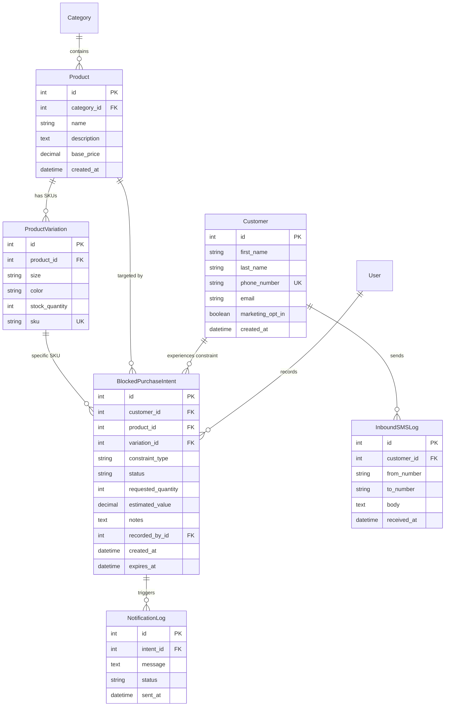
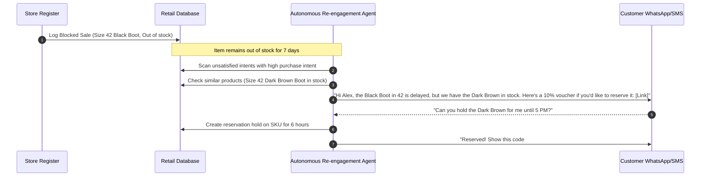

# Comprehensive System Handover & Enterprise Upgrade Roadmap
## Retail Purchase Constraint Management System (RPCMS) → Next-Gen Retail OS
**Target Audience**: Claude AI & Principal Engineering Team  
**Handover Date**: October 2026  
**Document Version**: 2.0.0 (Master Handover Edition)

---

## Table of Contents
1. [Executive Summary & Handover Context](#1-executive-summary--handover-context)
2. [What Has Been Built: Complete Codebase Audit](#2-what-has-been-built-complete-codebase-audit)
   - 2.1 Technology Stack & Architectural Patterns
   - 2.2 Repository Directory & File Inventory
   - 2.3 Database Schema & Relational Models
   - 2.4 Service & Selector Architecture
   - 2.5 End-to-End Operational Workflows
   - 2.6 REST API Specification
3. [Technical Debt, Bugs & Redundancy Audit](#3-technical-debt-bugs--redundancy-audit)
   - 3.1 The Notification Subsystem: Root Causes of Fragility & Failures
   - 3.2 Duplicate Logic & Overlapping Service Functions
   - 3.3 Asynchronous Execution vs. Local Development Friction
4. [UI/UX & Aesthetics Critique: Removing the "AI-Generated" Feel](#4-uiux--aesthetics-critique-removing-the-ai-generated-feel)
   - 4.1 Critique of Current Styling (Neon Cyan, Violet, Glassmorphism)
   - 4.2 Modern Enterprise Design System Mandate
   - 4.3 Missing Pages & Workflows to Implement
5. [The Platform Upgrade Vision: From Constraint Tool to Retail OS](#5-the-platform-upgrade-vision-from-constraint-tool-to-retail-os)
   - 5.1 Architecture of a Modern Retail Operating System (Shopify / Square / Toast Paradigm)
   - 5.2 Enterprise Modular Monolith / Microservices Topology
6. [Agentic AI & Model Context Protocol (MCP) Integration](#6-agentic-ai--model-context-protocol-mcp-integration)
   - 6.1 MCP Tool Server Architecture
   - 6.2 Autonomous Agents Specification
7. [Cloud Infrastructure, Security & Modern Communications Stack](#7-cloud-infrastructure-security--modern-communications-stack)
   - 7.1 Cloud Architecture (AWS / GCP / Cloudflare)
   - 7.2 Multi-Channel Communication Stack (SMS, WhatsApp, Email, Push)
8. [Phase-by-Phase Execution Roadmap for Claude AI](#8-phase-by-phase-execution-roadmap-for-claude-ai)

---

## 1. Executive Summary & Handover Context

This document is the official technical transition specification transferring ownership of the **Retail Purchase Constraint Management System (RPCMS)** codebase to **Claude AI** and the engineering team.

### The Problem Solved So Far
In traditional retail, when a customer walks into a brick-and-mortar store or visits a digital catalog seeking a specific product, size, or color that is out of stock, they leave empty-handed. This unfulfilled demand represents **unrecorded lost revenue**. 

RPCMS was engineered to eliminate this blind spot. It allows store staff to log blocked sales in 3 taps, tracks lost vs. recovered revenue, monitors inventory restocks, and dispatches customer notifications when requested items become available.

### Why Hand Over Now?
While the core proof-of-concept and data model are established, the current foundation is an isolated, single-purpose service with technical debt, brittle notification pipelines, overlapping code paths, and an aesthetic that feels noticeably "AI-generated" (neon glows, purple/cyan gradients, and heavy glassmorphism).

The strategic objective for Claude AI is to:
1. **Stabilize and clean up** existing redundancies and communication flaws.
2. **Elevate the visual design** to a world-class, clean, enterprise-grade B2B retail operating system (like Shopify Polaris, Toast POS, or Linear).
3. **Expand from a single tool into a unified Retail Operating System** (POS, multi-location inventory, unified CRM, and sales recovery).
4. **Infuse Model Context Protocol (MCP) servers and autonomous AI agents** to deliver real-time demand forecasting, autonomous stock replenishment, and conversational customer re-engagement.

---

## 2. What Has Been Built: Complete Codebase Audit

### 2.1 Technology Stack & Architectural Patterns
* **Backend Framework**: Python 3.12+, Django 5.2, Django REST Framework (DRF) 3.15+
* **Asynchronous Task Queue**: Celery 5.3+ with Redis as message broker and result backend
* **Database**: SQLite for local rapid iteration (`db.sqlite3`); PostgreSQL connection pooling via `dj-database-url` for production
* **Frontend**: Django Server-Side Templates, Tailwind CSS (standalone bundle in `static/js/tailwind.js`), Chart.js for data visualization, custom Vanilla CSS tokens
* **Reporting**: ReportLab for PDF document generation; Python standard library `csv` for spreadsheet streaming
* **Static Asset Delivery**: WhiteNoise with compressed manifest storage

The codebase follows the **Service-Selector Pattern**:
* **Services (`services.py` / `services/`)**: Responsible for mutations, database writes, external API integrations, and Celery task dispatches. Views and controllers should never mutate business state directly.
* **Selectors (`selectors.py`)**: Responsible for all database queries, complex filters, KPI aggregations, and business logic reads.

---

### 2.2 Repository Directory & File Inventory

```
retail_system/
├── core/
│   ├── settings.py              # Central Django configuration (apps, middleware, databases, Celery, Twilio)
│   ├── urls.py                  # Global URL routing (HTML pages + /api/ endpoints)
│   ├── celery.py                # Celery application initialization and broker configuration
│   ├── api_views.py             # Health check endpoints (/api/health/)
│   └── wsgi.py / asgi.py        # Web server gateway interfaces
│
├── accounts/                    # User authentication and store staff identity
│   ├── models.py                # Custom User model extending AbstractUser (phone_number, is_staff_member)
│   ├── urls.py & views.py       # Login, Logout, and registration views
│   └── admin.py                 # Admin registration for User
│
├── products/                    # Product catalog and physical variations
│   ├── models.py                # Category, Product (base price), ProductVariation (size, color, SKU, stock)
│   ├── services.py              # Category & product mutations; update_stock_quantity()
│   ├── selectors.py             # Filtered catalog queries and low-stock filters
│   ├── serializers.py           # DRF serializers (CategorySerializer, ProductSerializer, ProductVariationSerializer)
│   ├── views.py & urls.py       # Catalog views and template rendering
│   └── api_views.py             # REST API endpoints for products and variations
│
├── customers/                   # Customer profiles and compliance directory
│   ├── models.py                # Customer (first_name, last_name, phone_number, email, marketing_opt_in)
│   ├── services.py              # Customer creation, lookup by phone, opt-in toggling
│   ├── selectors.py             # Customer search and transaction history selectors
│   ├── serializers.py           # CustomerSerializer with phone validation
│   └── api_views.py             # REST endpoints for customer management
│
├── intents/                     # Core Business Domain: Blocked Purchase Intents
│   ├── models.py                # BlockedPurchaseIntent (constraint_type, status, estimated_value, expires_at)
│   ├── services.py              # create_blocked_purchase_intent(), update_intent_status()
│   ├── selectors.py             # get_active_intents(), get_intent_kpis(), expiry exclusion filters
│   ├── serializers.py           # BlockedPurchaseIntentSerializer
│   ├── views.py & urls.py       # Intent list, detail, and cashier logging views
│   └── api_views.py             # REST endpoints for intent CRUD
│
├── notifications/               # Outbound alerts, inbound SMS webhooks, and Celery workers
│   ├── models.py                # NotificationLog (status: Sent/Failed), InboundSMSLog (webhook audit)
│   ├── services.py              # SMSService (Twilio WhatsApp API integration wrapper)
│   ├── tasks.py                 # Celery task send_restock_notification_task()
│   ├── signals.py               # post_save signal on NotificationLog (updates intent status)
│   ├── views.py & api_views.py  # Twilio inbound webhook handler (/api/notifications/webhook/)
│   └── urls.py                  # Webhook routes
│
├── analytics/                   # Business intelligence & KPI aggregation engine
│   ├── selectors.py             # get_dashboard_kpis(), get_constraint_distribution(), get_revenue_trends()
│   └── api_views.py             # REST endpoints delivering Chart.js datasets
│
├── reports/                     # Data export engine
│   ├── views.py                 # ExportCSVReportView, ExportPDFReportView
│   └── services.py              # ReportLab canvas and table generation
│
├── dashboard/                   # Main store manager UI and floor register interface
│   ├── views.py                 # Home dashboard view packaging selectors for templates
│   └── urls.py                  # Dashboard routing
│
├── services/                    # Central cross-domain service layer [NOTE: High redundancy with app services]
│   ├── customer_service.py      # Customer profile helpers
│   ├── intent_service.py        # resolve_blocked_intents_for_variation() [Synchronous notification trigger]
│   ├── inventory_service.py     # update_stock(), resolve_intents_for_variation_async() [Celery trigger]
│   └── notification_service.py  # Africa's Talking simulation wrapper
│
├── templates/                   # Global HTML template tree
│   ├── base.html                # Master layout (contains CSS variables, sidebar, theme toggle)
│   ├── dashboard/home.html      # KPI cards, Chart.js charts, Quick Intent cashier modal, recent table
│   ├── products/                # Product catalogs, SKU modals, stock management screens
│   ├── intents/                 # Detailed intent management and filtering table
│   ├── customers/               # Customer directory and purchase histories
│   └── accounts/                # Authentication forms
│
├── static/                      # Static resources (Tailwind bundle, Chart.js, logos, icons)
├── docs/                        # Technical documentation and workflow specs
├── populate_data.py             # Production-like database seeder (populates shoes, sizes, constraints, customers)
├── send_sms.py                  # Standalone CLI script testing Twilio WhatsApp dispatch
└── requirements.txt             # Pip dependency manifest
```

---

### 2.3 Database Schema & Relational Models



#### Detailed Model Specifications
1. **`accounts.User`**:
   - `phone_number` (`CharField(max_length=15)`, nullable)
   - `is_staff_member` (`BooleanField`, default `False`): Distinguishes store cashiers from backend system admins.
2. **`products.Product` & `ProductVariation`**:
   - Products define base price and metadata.
   - Variations define physical inventory with unique SKUs (e.g., `NIK-AM90-BLK-42`).
   - `stock_quantity` tracks real physical inventory.
3. **`customers.Customer`**:
   - `phone_number` is unique and indexed for fast lookup at floor checkout.
   - `marketing_opt_in` (`BooleanField`, default `True`): Critical for TCPA/GDPR compliance. If `False`, the system silences all marketing and restock notifications.
4. **`intents.BlockedPurchaseIntent`**:
   - `constraint_type`: Limited to actionable choices:
     - `Size unavailable`
     - `Color unavailable`
     - `Out of stock`
     - `Price too high`
     - `Budget mismatch`
   - `status`: State machine:
     `Pending` $\rightarrow$ `Monitoring` $\rightarrow$ `Resolved` $\rightarrow$ `Customer Notified` $\rightarrow$ `Recovered` (or `Closed`).
   - `expires_at`: Defaults to `created_at + 30 days`. **Crucial Rule**: Any intent past its `expires_at` date is excluded from notification loops and restock aggregates.
5. **`notifications.NotificationLog` & `InboundSMSLog`**:
   - Audit trail of all outbound alerts and incoming webhook replies.

---

### 2.4 Service & Selector Architecture

```
                  ┌─────────────────────────────────────────┐
                  │          HTTP Request / API Call        │
                  └────────────────────┬────────────────────┘
                                       │
                    ┌──────────────────┴──────────────────┐
                    ▼                                     ▼
        ┌───────────────────────┐             ┌───────────────────────┐
        │     Write Operation   │             │     Read Operation    │
        │     (Mutations)       │             │     (Queries/KPIs)    │
        └───────────┬───────────┘             └───────────┬───────────┘
                    │                                     │
                    ▼                                     ▼
        ┌───────────────────────┐             ┌───────────────────────┐
        │     Service Layer     │             │     Selector Layer    │
        │   (services/*.py)     │             │   (*/selectors.py)    │
        └───────────┬───────────┘             └───────────┬───────────┘
                    │                                     │
         ┌──────────┴──────────┐                          │
         ▼                     ▼                          ▼
  ┌──────────────┐      ┌──────────────┐           ┌──────────────┐
  │ Database     │      │ Redis Queue  │           │ Database     │
  │ Write/Commit │      │ Celery Delay │           │ Read Only    │
  └──────────────┘      └──────────────┘           └──────────────┘
```

* **Selectors Never Mutate**: All functions in `selectors.py` are strictly read-only. They utilize `.values()`, `.annotate()`, and `.aggregate()` to minimize memory footprint.
* **Services Guarantee Atomicity**: State changes, stock updates, and intent creations execute within transactions or explicit service functions.

---

### 2.5 End-to-End Operational Workflows

#### Workflow A: Cashier "3-Tap" Intent Capture
1. Cashier on the retail floor identifies an unfulfilled customer request.
2. The Cashier opens the **Quick Intent Modal** from the dashboard or product screen.
3. Product, variation, and estimated lost value auto-populate.
4. Cashier inputs the customer's phone number.
5. Submitting creates a `Customer` profile (if new) and logs the `BlockedPurchaseIntent` with `status='Pending'` and `expires_at = now + 30 days`.

#### Workflow B: Asynchronous Stock Replenishment & Resolution
1. Store receives a shipment. The manager updates variation stock quantity (`stock_quantity > 0`) via `inventory_service.update_stock()`.
2. The service queries all active, non-expired intents (`expires_at > now` and `status IN ['Pending', 'Monitoring']`).
3. For each matching intent:
   - Database status updates immediately to `Resolved`.
   - A background task `send_restock_notification_task.delay(intent.id)` is pushed to Redis.
4. The HTTP response completes instantly without blocking on external SMS APIs.

#### Workflow C: Celery Background Notification Dispatch
1. Celery worker pulls the task from Redis.
2. Checks `customer.marketing_opt_in`. If `False`, aborts with an opt-out log.
3. Checks if a notification was already sent to avoid duplicate spam.
4. Formats message with mandatory opt-out instructions: `"Hello [Name], the [Product] you requested is now in stock. Reply STOP to opt out."`
5. Calls messaging client (Twilio / SMS API).
6. Writes `NotificationLog(status='Sent')` and updates `BlockedPurchaseIntent(status='Customer Notified')`.

#### Workflow D: Inbound Webhook Processing (Customer Reply)
1. Customer replies `"STOP"` or `"HOLD IT"` to the notification.
2. Twilio sends a POST webhook to `/api/notifications/webhook/`.
3. Django processes the payload, logs `InboundSMSLog`, and if `"STOP"` is detected, immediately flips `customer.marketing_opt_in = False`.
4. Returns compliant TwiML response.

---

### 2.6 REST API Specification

| Endpoint | Method | Description | Primary Payload / Parameters |
| :--- | :--- | :--- | :--- |
| `/api/health/` | `GET` | Health check probe | Returns `{"status": "healthy"}` |
| `/api/categories/` | `GET`, `POST` | Category list & creation | `{"name": "string", "description": "text"}` |
| `/api/products/` | `GET`, `POST` | Catalog list & creation | Nested variation list included |
| `/api/variations/` | `GET`, `POST` | SKU management | Filterable by `?product=<id>` |
| `/api/customers/` | `GET`, `POST` | Customer directory | Searchable by `?phone=<number>` |
| `/api/intents/` | `GET`, `POST` | Blocked intent tracking | Filterable by `?status=&product=&customer=` |
| `/api/dashboard/` | `GET` | Aggregated metrics | Total blocked, lost vs recovered revenue, restock suggestions |
| `/api/analytics/` | `GET` | Chart datasets | Breakdown by constraint type, monthly recovery trend |
| `/api/reports/` | `GET` | Report metadata | Status summaries |
| `/api/reports/export/csv/` | `GET` | CSV download | Streamed CSV attachment |
| `/api/reports/export/pdf/` | `GET` | PDF download | Streamed ReportLab PDF attachment |
| `/api/notifications/webhook/` | `POST` | Twilio inbound webhook | Inbound SMS/WhatsApp payloads |

---

## 3. Technical Debt, Bugs & Redundancy Audit

This section documents the specific architectural flaws, bugs, and redundancies that Claude AI must refactor and resolve.

### 3.1 The Notification Subsystem: Root Causes of Fragility & Failures

The user noted: *"I know the notification part is not working, there's some redundancy somehow also..."*

Here is the exact diagnostic breakdown of why notifications currently fail or behave inconsistently:

1. **WhatsApp Sandbox Join-Code Requirement**:
   - The current implementation in `notifications/services.py` and `notifications/tasks.py` points to Twilio WhatsApp (`whatsapp:+14155238886`).
   - In Twilio's sandbox, **a customer cannot receive a WhatsApp message unless they have first sent a manual join code** (e.g. `"join <sandbox-keyword>"`) to the Twilio number within the last 24 hours.
   - When the Celery task attempts to send a notification to an arbitrary customer phone number (`+254...`, `+1...`), Twilio returns `Error 63015: Channel Sandbox can only send messages to joined numbers`.
   - **Fix for Claude AI**: Switch to standard SMS via Twilio Messaging Service or integrate a direct SMS gateway (Africa's Talking / Vonage / AWS SNS), or use pre-approved Meta WhatsApp Cloud API templates for production.

2. **Dual Conflicting Implementations**:
   - `services/notification_service.py` simulates SMS via an "Africa's Talking" logger and directly mutates the database.
   - `notifications/services.py` implements a static `SMSService` calling Twilio WhatsApp.
   - `notifications/tasks.py` duplicates almost the exact same Twilio WhatsApp logic inside a Celery task.
   - `send_sms.py` in the root directory is a standalone CLI script that has hardcoded Twilio credentials and is completely detached from the Django app.
   - **Fix for Claude AI**: Consolidate all notification logic into a single modular gateway interface in `notifications/services.py` with provider adapters (TwilioSMSAdapter, AfricasTalkingAdapter, ResendEmailAdapter, MockSimulatorAdapter) and invoke it exclusively through Celery tasks.

3. **Conflicting Signals and Explicit Mutations**:
   - `notifications/signals.py` defines a `post_save` signal on `NotificationLog` that mutates `intent.status = 'Customer Notified'`.
   - Concurrently, both `notifications/tasks.py` and `services/notification_service.py` also manually execute `intent.status = 'Customer Notified'; intent.save()`.
   - This creates dual update paths and triggers unnecessary database writes.
   - **Fix for Claude AI**: Remove `notifications/signals.py` completely. Rely strictly on explicit service/task transitions.

4. **Celery Worker Execution Dependency**:
   - In local development, if Redis is not running or the developer has not started `celery -A core worker`, the tasks pushed to Redis are queued but never processed.
   - The database intent gets updated to `Resolved`, but the notification remains un-dispatched indefinitely.
   - **Fix for Claude AI**: Implement a developer fallback mode in `settings.py` (`CELERY_TASK_ALWAYS_EAGER = DEBUG`) so local development does not require a separate running worker container unless explicitly enabled.

---

### 3.2 Duplicate Logic & Overlapping Service Functions

The project currently contains two competing service locations:
1. App-level services: `intents/services.py`, `products/services.py`, `notifications/services.py`.
2. Root services directory: `services/intent_service.py`, `services/inventory_service.py`, `services/notification_service.py`, `services/customer_service.py`.

* **The Problem**:
  `intents/services.py` defines `create_blocked_purchase_intent()`.
  `services/intent_service.py` defines the exact same `create_blocked_purchase_intent()` function.
  `services/intent_service.py` resolves intents **synchronously** calling `services.notification_service.send_resolution_notification(intent)`.
  Meanwhile, `services/inventory_service.py` resolves intents **asynchronously** calling Celery's `send_restock_notification_task.delay(intent.id)`.

* **Refactoring Blueprint for Claude AI**:
  - Deprecate the root `services/` folder or make it the single authoritative domain layer.
  - Recommended architecture: Place services inside each domain app (`intents/services.py`, `products/services.py`, `notifications/services.py`) to preserve modular monolith encapsulation.
  - Delete `services/notification_service.py` and the unused `send_sms.py` script.

---

## 4. UI/UX & Aesthetics Critique: Removing the "AI-Generated" Feel

The user noted: *"The UI is a bit feels like AI generated, blue and purple, glassmorphism, and the rainbow or what color is this, a weird mixture of colors that we're using, and all those, you should include it because we need to change it appropriately..."*

### 4.1 Critique of Current Styling
An examination of `templates/base.html` reveals standard AI archetype design tropes:
1. **The "Cyberpunk AI Palette"**:
   - `--accent-primary: #00E5FF` (Neon electric cyan)
   - `--accent-secondary: #a855f7` (Vivid purple/violet)
   - `--accent-danger: #FF3B5C` (Hot neon pink)
   - `--accent-success: #00FF85` (Toxic neon green)
2. **Excessive Glassmorphism & Diffuse Glows**:
   - `backdrop-filter: blur(12px)`
   - Glowing box shadows: `0 0 20px rgba(0, 229, 255, 0.35)` and `0 0 20px rgba(168, 85, 247, 0.35)`
   - Translucent container borders and gradient overlay backgrounds (`linear-gradient(135deg, rgba(9, 18, 26, 0.78) 0%, rgba(16, 9, 26, 0.78) 100%)`).
3. **Why This Fails Retail Users**:
   - High cognitive fatigue under retail store fluorescent lighting.
   - Cashiers and store managers need high contrast, instant readability, and dense data layouts—not decorative neon glows and transparent glass panels.
   - It signals a student or hobbyist AI demo rather than a $50M enterprise B2B SaaS platform.

---

### 4.2 Modern Enterprise Design System Mandate
Claude AI must replace the current theme with a **curated, restrained, executive-grade design system** inspired by **Shopify Polaris, Stripe Dashboard, and Linear**:

```
┌────────────────────────────────────────────────────────────────────────┐
│                        Enterprise Color Tokens                         │
├───────────────────┬───────────────────┬────────────────────────────────┤
│ Token Name        │ Hex Code          │ Usage                          │
├───────────────────┼───────────────────┼────────────────────────────────┤
│ Surface Primary   │ #FFFFFF (Light)   │ Main app surface               │
│                   │ #0F172A (Dark)    │ Slate 900 dark background      │
│ Surface Secondary │ #F8FAFC (Light)   │ Sidebar, table headers         │
│                   │ #1E293B (Dark)    │ Slate 800 cards and panels     │
│ Surface Border    │ #E2E8F0 (Light)   │ 1px crisp, non-glowing borders │
│                   │ #334155 (Dark)    │ Subtle slate dividers          │
│ Text Primary      │ #0F172A / #F8FAFC │ High-contrast headers & data   │
│ Text Secondary    │ #64748B / #94A3B8 │ Labels, timestamps, hints      │
│ Primary Brand     │ #2563EB (Indigo)  │ Authoritative call-to-actions  │
│                   │ or #0F766E (Teal) │ (No neon cyan / purple)        │
│ Success           │ #16A34A (Emerald) │ Recovered sales, in-stock      │
│ Warning           │ #D97706 (Amber)   │ Pending constraints            │
│ Danger            │ #DC2626 (Rose)    │ Lost sales, out of stock       │
└───────────────────┴───────────────────┴────────────────────────────────┘
```

* **Typography**: Clean, neutral geometric sans: `Inter` or `Plus Jakarta Sans` with strict typographic hierarchy (11px micro-labels, 13px tabular data, 14px body, 18px card headers, 24px metric counters).
* **Components**: Solid backgrounds, crisp 1px borders (`border-slate-200 dark:border-slate-800`), standard 6px/8px border-radius, clean drop shadows (`shadow-sm` / `shadow`).
* **Zero Glassmorphism**: Remove all `backdrop-blur`, glowing radial shadows, and decorative rainbow gradients.

---

### 4.3 Missing Pages & Workflows to Implement
To transform this into a true product, Claude AI must build:
1. **Public Marketing & Landing Page (`/`)**:
   - Value proposition for retail chains ("Recover 12-18% of walk-out sales").
   - Interactive ROI calculator (Store foot traffic $\times$ average stockout rate $\times$ recovery rate = recovered annual revenue).
   - Testimonials, architecture diagrams, and "Book Demo" / "Sign Up" CTAs.
2. **Modern Authentication & Multi-Tenant Onboarding (`/login`, `/register`)**:
   - Clean split-screen authentication layout (hero retail imagery on left, crisp auth form on right).
   - Organization / Store creation workflow (Store Name, Currency, Timezone, Regional Phone Format).
3. **Cashier Fast POS Terminal View (`/pos/` or `/floor/`)**:
   - Dedicated high-speed, full-screen touch layout designed for floor tablets or barcode scanners.
   - Giant numeric keypad, quick product barcode search, 2-touch constraint logging.
4. **Customer Profile & Communication Timeline (`/customers/<id>/`)**:
   - Complete audit trail showing all blocked intents, SMS notifications sent, customer replies, and lifetime recovered spend.

---

## 5. The Platform Upgrade Vision: Dual-Track Strategy (Retail OS vs. Headless Integration Service)

> [!IMPORTANT]
> **Critical Architectural Insight from User Direction**:
> Retailers who have run their stores for 10–20 years on existing POS systems (e.g., NCR, Micros, legacy Windows POS machines, Shopify POS, Lightspeed, Square, Odoo) **will not rip and replace their entire core system** just to get lost-sale tracking. Doing so causes massive business disruption, risk of catalog/financial data loss, and staff retraining resistance.
> 
> Therefore, Claude AI must build the system following a **Dual-Track Architecture**:
> * **Track 1: All-in-One Retail OS**: For new stores, greenfield deployments, or merchants actively looking to replace obsolete infrastructure.
> * **Track 2: "Plug & Play" Headless Integration Service / B2B Developer Tool**: A modular, embeddable service that existing POS/e-commerce systems can "borrow" and integrate via APIs, widgets, or plugins with zero disruption—monetized on a usage/rev-share basis ("paying a small shilling per recovered sale").

```
                                  ┌───────────────────────────────────────────┐
                                  │      RPCMS Core Recovery & AI Engine      │
                                  └─────────────────────┬─────────────────────┘
                                                        │
                         ┌──────────────────────────────┴──────────────────────────────┐
                         ▼                                                             ▼
           ┌───────────────────────────┐                                 ┌───────────────────────────┐
           │          Track 1          │                                 │          Track 2          │
           │  Full Standalone Retail OS│                                 │   Headless "Plug & Play"  │
           │  (All-in-One POS & ERP)   │                                 │    Integration Service    │
           └─────────────┬─────────────┘                                 └─────────────┬─────────────┘
                         │                                                             │
         ┌───────────────┼───────────────┐                             ┌───────────────┼───────────────┐
         ▼               ▼               ▼                             ▼               ▼               ▼
   [Unified POS]   [Inventory]     [CRM/Loyalty]                 [Embeddable     [Shopify/Square [Developer SDKs 
   (Cashier screen (Multi-warehouse (Profiles &                   Widget.js]      POS Extensions]  & REST/Webhooks]
    & Barcode)      & Suppliers)    Ledgers)                      (Any web POS)   (App Store)      (Legacy Win POS)
```

---

### 5.1 Track 1: Architecture of a Modern Retail Operating System (All-in-One)

For greenfield merchants, the system serves as their primary daily operating software:

```
┌─────────────────────────────────────────────────────────────────────────────────┐
│                           Unified Retail OS Platform                            │
├─────────────────────────────────────────────────────────────────────────────────┤
│                               Presentation Layer                                │
│   ┌─────────────────────┐  ┌─────────────────────┐  ┌───────────────────────┐   │
│   │   Marketing Landing │  │   Store Manager Hub │  │  Floor POS Terminal  │   │
│   │   & Merchant Auth   │  │   (Analytics & Ops) │  │  (Fast Touch Checkout)│   │
│   └─────────────────────┘  └─────────────────────┘  └───────────────────────┘   │
├─────────────────────────────────────────────────────────────────────────────────┤
│                             Core Commerce Modules                               │
│  ┌────────────────────┐ ┌────────────────────┐ ┌──────────────────────────────┐ │
│  │ Point of Sale (POS)│ │ Catalog & Variants │ │ Multi-Location Inventory     │ │
│  │ Orders & Checkout  │ │ Barcodes, Categories│ │ Warehouses, Stock Transfers │ │
│  └────────────────────┘ └────────────────────┘ └──────────────────────────────┘ │
│  ┌────────────────────┐ ┌────────────────────┐ ┌──────────────────────────────┐ │
│  │ CRM & Loyalty      │ │ Blocked Intent     │ │ Omnichannel Communications   │ │
│  │ Customer Profiles  │ │ Recovery Engine    │ │ SMS, WhatsApp, Email, Push   │ │
│  └────────────────────┘ └────────────────────┘ └──────────────────────────────┘ │
├─────────────────────────────────────────────────────────────────────────────────┤
│                            Agentic AI & MCP Layer                               │
│  ┌────────────────────────────────────────────────────────────────────────────┐ │
│  │ Model Context Protocol (MCP) Server: Inventory, CRM, Orders, Restock       │ │
│  │ Autonomous Agents: Demand Forecast, Smart Re-Engagement, Restock Bot       │ │
│  └────────────────────────────────────────────────────────────────────────────┘ │
├─────────────────────────────────────────────────────────────────────────────────┤
│                             Data & Event Foundation                             │
│       PostgreSQL (Relational)  │  Redis (Broker/Cache)  │  Celery / Workers     │
└─────────────────────────────────────────────────────────────────────────────────┘
```

---

### 5.2 Track 2: The Headless "Plug & Play" Integration Service & Developer Platform

This track allows developers, POS vendors, and existing merchants to adopt our blocked-intent recovery engine without altering their current database or POS machine.

#### 1. Embeddable Cashier Web Widget (`widget.js`)
Any web-based or Electron-based POS (e.g. Shopify POS, Square for Retail, Vend, Lightspeed) can load our 3-tap capture modal with a single line of script:
```html
<!-- Embed into existing POS receipt/catalog view -->
<script src="https://cdn.retailos.io/v1/intent-widget.js" 
        data-store-id="store_8923a" 
        data-api-key="pk_live_xxxxxxxx"></script>
```
* **How It Works**: Adds a non-intrusive floating button or hotkey (`Ctrl + M` / `F9`) labeled **"Log Missed Sale"**. When clicked, it detects current SKU details from the POS DOM or API and provides the 3-tap cashier prompt.

#### 2. POS Marketplace Extensions
* **Shopify POS UI Extension**: A native extension tile in the Shopify POS smart grid. When an item is zero-stock, the cashier taps "Capture Demand", inputs the customer phone, and the app connects directly to our recovery API.
* **Square & Clover App Marketplace Add-on**: An automated prompt triggered whenever a barcode scan returns "Item Out of Stock".

#### 3. Inbound Webhook Sync (Zero Database Migration)
Instead of forcing the store to manage stock in our system:
* The store's existing system (e.g., Shopify, Odoo, SAP, WooCommerce) sends an automated webhook whenever inventory is adjusted:
  `POST /api/v1/integrations/inventory-webhook/`
  ```json
  {
    "event": "inventory.updated",
    "sku": "NIK-AM90-BLK-42",
    "new_quantity": 15,
    "store_id": "store_8923a"
  }
  ```
* Our service intercepts the webhook, checks for matching active intents, marks them `Resolved`, and dispatches the customer restock alerts automatically! The merchant never leaves their existing POS.

#### 4. Legacy Windows POS Desktop Agent (For 20-Year-Old Systems)
* A lightweight, headless background service (written in Python/Go) for legacy retail environments (NCR, Micros, legacy Windows 7/10 machines).
* Can monitor a local inventory CSV/SQL export or listen for a global hotkey from floor cashiers.

#### 5. Developer Monetization Model ("Pay a Small Shilling")
Developers and POS companies integrate our API and pay via:
* **Per-Notification / Micro-Charge**: E.g., $0.05 per successfully delivered alert.
* **Performance / Revenue-Share**: E.g., 2%–5% commission on recovered sales verified via unique recovery discount codes (`SAVE10-REC492`).
* **SaaS Tier**: Free up to 50 intents/month; $49/month for unlimited intents and predictive AI restock analytics.


---

## 6. Agentic AI & Model Context Protocol (MCP) Integration

### 6.1 MCP Tool Server Architecture
Claude AI must construct an MCP Server interface exposing the retail system's capabilities to Claude and autonomous agents.

```
┌─────────────────────┐
│   Claude AI / LLM   │
└──────────┬──────────┘
           │ JSON-RPC (stdio / SSE)
           ▼
┌────────────────────────────────────────────────────────┐
│               Retail System MCP Server                 │
├────────────────────────────────────────────────────────┤
│  Tools Exposed:                                        │
│  1. get_stock_level(sku, warehouse_id)                 │
│  2. list_blocked_intents(status, min_value)            │
│  3. generate_purchase_order(supplier_id, items)        │
│  4. dispatch_personalized_recovery_offer(intent_id)    │
│  5. query_customer_intent_history(phone_number)        │
│  6. calculate_restock_roi_matrix()                     │
└────────────────────────────────────────────────────────┘
```

#### MCP Tool Definitions to Implement:
1. `get_unfulfilled_demand(category_id, days)`: Analyzes blocked sales patterns and ranks items by uncaptured revenue.
2. `trigger_supplier_replenishment(variation_id, recommended_quantity)`: Connects to supplier ERP or drafts PO for manager approval.
3. `negotiate_alternate_sale(intent_id, alternative_variation_id, discount_percentage)`: Sends customer an alternative offer if the exact SKU is discontinued.

---

### 6.2 Autonomous Agents Specification



1. **Autonomous Demand & Restock Agent**:
   - Monitors velocity of blocked intents alongside inventory burn rates.
   - Recommends safety stock levels based on lost sales data.
2. **Conversational Re-engagement Agent**:
   - Replaces static "product back in stock" SMS with an intelligent conversational assistant capable of answering questions, booking store holds, and suggesting alternative sizes/colors.

---

## 7. Cloud Infrastructure, Security & Modern Communications Stack

### 7.1 Cloud Architecture (AWS / GCP / Cloudflare)

```
                              [ Cloudflare DNS / CDN / WAF ]
                                            │
                                            ▼
                             [ Application Load Balancer ]
                                            │
                      ┌─────────────────────┴─────────────────────┐
                      ▼                                           ▼
          [ Django Web Service ]                      [ Celery Background Workers ]
          (AWS ECS / GCP Cloud Run)                   (AWS ECS / GCP Cloud Run)
                      │                                           │
                      ├─────────────────────┬─────────────────────┤
                      ▼                     ▼                     ▼
             [ Managed PostgreSQL ]   [ Managed Redis ]    [ S3 / Cloud Storage ]
             (RDS / Cloud SQL)        (ElastiCache/Upstash) (PDF reports & static)
```

* **Compute**: Stateless Docker containers deployed on AWS ECS (Fargate) or Google Cloud Run.
* **Database**: PostgreSQL 16 with automatic daily snapshots and read-replicas for analytical queries.
* **Cache & Broker**: Managed Redis (AWS ElastiCache or Upstash Redis).
* **Storage**: AWS S3 or GCP Cloud Storage for generated PDF invoices, reports, and catalog media.
* **Security & Auth**: JWT / Session auth with strict role-based access control (`StoreCashier`, `StoreManager`, `RegionalDirector`, `PlatformAdmin`).

---

### 7.2 Multi-Channel Communication Stack (SMS, WhatsApp, Email, Push)

Replace the fragile Twilio WhatsApp sandbox with a production-grade multi-channel router:

1. **Direct SMS Providers**:
   - **North America**: Twilio Messaging Service with approved A2P 10DLC brand registration.
   - **Africa & Middle East**: Africa's Talking SMS API with registered alphanumeric sender ID (e.g., `"RETAIL-ALERT"`).
   - **Global Fallback**: Vonage / Sinch SMS Gateway.
2. **Meta WhatsApp Cloud API**:
   - Direct integration via official Meta Graph API using approved business HSM message templates (eliminates the sandbox join-code hurdle).
3. **Transactional Email**:
   - Integrate **Resend** or **AWS SES** for merchant back-in-stock digests, weekly sales recovery PDF reports, and customer receipts.
4. **Web & Cashier Push Notifications**:
   - Browser Web Push notifications for floor staff when a customer responds or when high-value restocks occur.

---

## 8. Phase-by-Phase Execution Roadmap for Claude AI

Claude AI should execute the modernization in 5 structured phases:

```
┌────────────────────────────────────────────────────────────────────────┐
│                 5-Phase Modernization & Upgrade Plan                   │
├─────────┬───────────────────────────────────┬──────────────────────────┤
│ Phase   │ Focus Area                        │ Deliverables             │
├─────────┼───────────────────────────────────┼──────────────────────────┤
│ Phase 1 │ Stabilization & Debt Elimination  │ • Deduplicate services   │
│         │                                   │ • Fix notifications      │
│         │                                   │ • Delete dead scripts    │
│         │                                   │ • Add eager Celery dev   │
├─────────┼───────────────────────────────────┼──────────────────────────┤
│ Phase 2 │ Enterprise UI Overhaul            │ • Remove glassmorphism   │
│         │                                   │ • Implement Slate theme  │
│         │                                   │ • Build Landing page     │
│         │                                   │ • Build Auth split-screen│
├─────────┼───────────────────────────────────┼──────────────────────────┤
│ Phase 3 │ Omnichannel Communications Engine │ • Resend / AWS SES email │
│         │                                   │ • A2P Twilio / AT SMS    │
│         │                                   │ • Two-way webhook engine │
├─────────┼───────────────────────────────────┼──────────────────────────┤
│ Phase 4 │ Retail OS & Headless Integration  │ • Cashier POS view (Track 1)   │
│         │ (Dual-Track Deployment)           │ • Embeddable widget.js (Track 2)│
│         │                                   │ • Inbound POS inventory webhook│
│         │                                   │ • Multi-location stock & CRM   │
├─────────┼───────────────────────────────────┼──────────────────────────┤
│ Phase 5 │ MCP Server & Agentic AI Layer     │ • Expose MCP tool suite  │
│         │                                   │ • Auto-restock predictor │
│         │                                   │ • Smart re-engagement bot│
└─────────┴───────────────────────────────────┴──────────────────────────┘
```

### Detailed Phase Milestones:

#### Phase 1: Stabilization & Tech Debt Elimination
- Delete `services/notification_service.py` and `send_sms.py`.
- Remove redundant signal in `notifications/signals.py`.
- Move business logic from root `services/` into respective domain apps (`intents/services.py`, `products/services.py`).
- Fix `notifications/services.py` with multi-provider fallback and clear SMS dispatching that does not fail on WhatsApp sandbox barriers.
- Set `CELERY_TASK_ALWAYS_EAGER = DEBUG` in `core/settings.py` so development runs seamlessly without background worker crashes.

#### Phase 2: Enterprise UI Redesign (Shopify/Linear Aesthetic)
- Overhaul `templates/base.html` CSS variables: strip neon cyan (`#00E5FF`), neon violet, glowing shadows, and backdrop blur.
- Apply high-contrast Slate palette (`#0F172A`, `#F8FAFC`, `#E2E8F0`, `#2563EB`).
- Build responsive, conversion-focused **Landing Page** at `/`.
- Build polished **Login & Onboarding** page at `/accounts/login/`.
- Enhance the Cashier Quick Intent modal with 1-click product quick-picker and clear feedback toasts.

#### Phase 3: Omnichannel Communication Engine
- Create `communications/` provider layer supporting SMS, WhatsApp, and Email.
- Implement transactional back-in-stock email alerts (HTML templates via Resend/SendGrid).
- Enhance webhook processing to parse natural language responses (e.g. "Reserve it for me", "I bought it elsewhere", "STOP").

#### Phase 4: Retail OS & Headless Integration (Dual-Track)
- **Track 1 (All-in-One)**: Add `/pos/` touch terminal view for floor cashiers and multi-location inventory support (`StoreLocation` model).
- **Track 2 (Headless Embeddable)**:
  - Create `static/js/intent-widget.js` (an embeddable 3-tap script that mounts onto any web/Electron POS like Shopify POS, Square Web, Lightspeed).
  - Implement `POST /api/v1/integrations/inventory-webhook/` to sync inventory adjustments from external legacy POS/Shopify and trigger customer restock dispatches without migrating the store's database.
  - Implement developer API key authentication (`X-API-Key`) with metered billing logging.
- Expand Analytics with predictive recovery rate calculations and multi-store performance charts.

#### Phase 5: MCP & Agentic AI Capabilities
- Build `retail_mcp_server.py` exposing inventory, intents, and notification tools.
- Implement automated demand forecasting script that outputs recommended order quantities based on unfulfilled constraints.
- Connect Claude AI as an autonomous agent able to interact with the system via standard MCP protocols.

---

## 9. Conclusion & Transition Sign-Off

The **Retail Purchase Constraint Management System** addresses a fundamental, multi-billion-dollar pain point in retail operations. By clearing the technical debt, ditching the "AI-generated" aesthetic for a clean enterprise interface, and scaling the architecture into an agentic Retail OS, Claude AI and the incoming development team will transform this application from a prototype into a high-value, production-grade enterprise platform.

*Document authored by Antigravity IDE Agent for seamless hand-off to Claude AI.*
